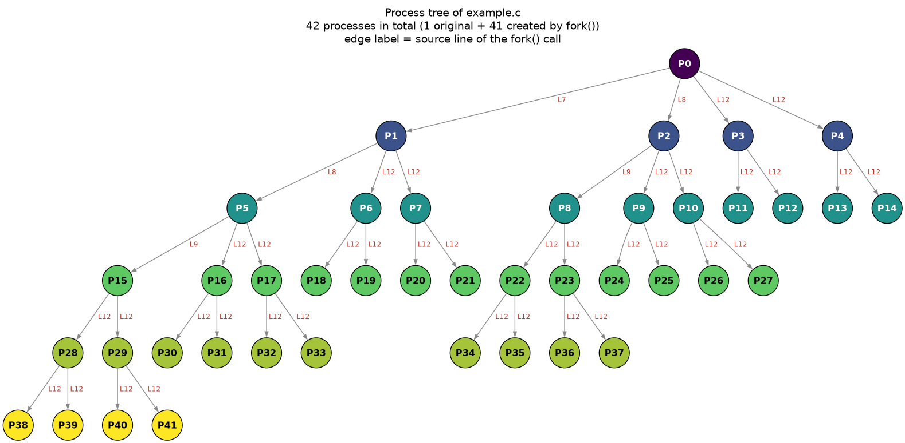

# fork-tree

Visualize the process tree created by `fork()` calls in a C program.



Ever stared at a classic exam question like *"how many processes does this program create?"* — `fork-tree` answers it by actually running the program and drawing the resulting tree with Graphviz.

## How it works

1. The C file is compiled with `gcc`, force-including a small tracing header (`-include`) that replaces every `fork()` call with a wrapper macro.
2. The wrapper calls the real `fork()` and, in the parent, appends a line `FORK parent_pid child_pid source_line` to a log file (single atomic `write` with `O_APPEND`).
3. The program is executed (with a timeout, killing the whole process group if it hangs), and the log is parsed into a tree.
4. The tree is rendered with Graphviz: nodes are colored by generation, and each edge is labeled with the source line of the `fork()` call that created the child.

Because the program is really executed, the result is exact for any code: loops, conditions, `fork()` inside `&&` / `||` expressions, etc.

## Requirements

- Linux / Unix with `gcc`
- [Graphviz](https://graphviz.org/) (`dot` binary) — e.g. `sudo dnf install graphviz` or `sudo apt install graphviz`
- Python ≥ 3.10 and [uv](https://docs.astral.sh/uv/) (or pip with the `graphviz` package)

## Usage

```bash
uv run tree_image.py example.c                  # -> example_tree.png
uv run tree_image.py example.c -o tree.svg --show
uv run tree_image.py example.c --pids           # label nodes with real PIDs
uv run tree_image.py example.c --args 3 foo     # pass arguments to the program
```

### Options

| Option | Description |
|---|---|
| `-o, --output FILE` | Output image; the extension picks the format (`.png`, `.svg`, `.pdf`, …). Default: `<file>_tree.png` |
| `--show` | Open the image after rendering |
| `--pids` | Label nodes with real PIDs instead of `P0`, `P1`, … (breadth-first order) |
| `--timeout SEC` | Seconds before killing the program (default: 10) |
| `--cflags "..."` | Extra gcc flags, e.g. `"-lm"` |
| `--args ...` | Arguments passed to the C program (must be last) |

## Example

[`example.c`](example.c):

```c
fork();
if (fork() == 0) {
    fork();
}
for (int i = 0; i < 2; i++) {
    if (fork() && fork())
        break;
}
```

Running `uv run tree_image.py example.c` produces the image shown at the top of this README.

## Project structure

- [`analyzer.py`](analyzer.py) — compiles, runs and traces the C program; returns a `ForkTrace`
- [`tree_image.py`](tree_image.py) — CLI that renders the `ForkTrace` with Graphviz

## Caveats

- The program is actually executed — only run code you trust.
- Only `fork()` calls in the compiled source file are traced (not those inside libraries, `vfork`, or `clone`).
- Programs that read from stdin get `/dev/null`.
